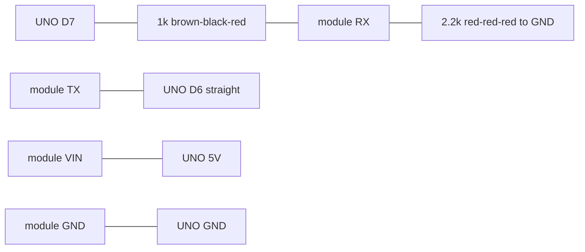

# -uno-tft-mmwave-presence

Handheld presence display for an Arduino UNO R3, a 2.8" ILI9341 TFT shield, and a DFRobot C4001 24 GHz mmWave radar.

The screen shows **PRESENT** or **CLEAR** in large type, a distance in meters, speed, and energy, plus a top-down picture of the beam. The C4001 reports distance, speed, and energy. It does not report a left/right angle, so the picture is a band across the whole beam. See [Direction](#direction).

Repository: [github.com/ironsbrodie-svg/-uno-tft-mmwave-presence](https://github.com/ironsbrodie-svg/-uno-tft-mmwave-presence)

## Parts

| Part | Notes |
| --- | --- |
| Arduino UNO R3 | Sketches build for `arduino:avr:uno`. |
| 2.8" TFT shield, resistive, ILI9341 | Adafruit product 1651, or a clone with the same SPI wiring. Touch is not used. |
| DFRobot C4001, UART | 25 m module is SEN0609 (default in the sketch). 12 m module is SEN0610. |
| 4 jumper wires | Female ends for the shield's stacking pins. |
| USB cable | Programming, and the first power source. |

The microSD slot is unused. There is no SD library. Digital pin 4 is still the card's chip select, so every sketch drives D4 HIGH and that pin stays free of the radar.

## What the screen shows

Portrait, USB socket at the top of the UNO. If the picture is upside down, set `TFT_ROTATION` to `2` at the top of `presence_display/presence_display.ino`.

| Region | Meaning |
| --- | --- |
| Green **PRESENT** / red **CLEAR** | Someone in the beam, or not. |
| Yellow distance | Smoothed range, for example `6.0m`. `--` when there is no range. Presence mode shows `HERE`. |
| Cone | Sensor at the bottom, looking up the screen. A yellow arc is the range across the full horizontal beam. The white number at the lower right is the configured maximum. |
| SPEED / ENERGY | Relative speed (m/s) and signal energy, in ranging mode. Hidden while the presence hold is coasting. |

`SEARCHING` means the sketch is waiting for a `$...*` frame. `CHECKING` means it has stopped the module and is reading the settings back. That happens on boot, and again after a link loss once a new frame is seen. `NO SENSOR` means no frames (power, or the module TX wire into D6). `NO RX` means `sensorStop` got no bytes at all: the module went silent. The sketch stays on that screen and retries. It does not open the live view. `NO SENSOR RX` means bytes are still arriving (usually frames) but the command never returned `Done`. That is the open command wire: UNO D7, or Mega pin 18, is not reaching module RX, while module TX still reaches the board. The sketch stays on that screen and retries. `CFG FAIL` names a later command that did not return `Done`. That banner stays up for about 1.2 s, then the live screen returns if a frame was seen after start, and the yellow line at the bottom is that command name. A frame from the other mode does not refresh the link timer. After 5 s with no matching frame the banner goes to `NO SENSOR`, then `CHECKING` runs again. A white dot just above the yellow line blinks only after a frame is accepted, and at most every 250 ms. The big distance ignores steps smaller than 7 cm. `WDT RESET` means the watchdog fired. It stays up for about 1.5 s and is then cleared, so a later yellow line can still say `CFG UNVERIFIED`.

The display runs with no Serial Monitor. The sketch does not wait for USB.

## Wiring

Do this with USB unplugged.

DFRobot's own Uno example uses D4 and D5. Do not use those pins with this shield. D4 is the microSD chip select.

### 1. UART / I2C switch

The 12 m SEN0610 wiki tells you to set the DIP switch on the back of the sensor to **UART** before the serial demo (and to IIC for the I2C demo).

The 25 m SEN0609 pinout is `VIN`, `GND`, `RX`, `TX`, `OUT`. A DFRobot forum report on that 25 m board says it has no DIP switch. If your board has the switch, set it to UART before power-up. If it has none, use the pins labeled RX and TX.

### 2. Seat the shield

1. Unplug USB and any barrel supply.
2. Set the UNO on the table with the USB socket away from you.
3. Line the shield up with every header. Its 2x3 plug must meet the UNO's ICSP header (the 2x3 pins near the middle, not a header at the edge).
4. Press straight down until the shield sits flush.

Adafruit 1651 uses stacking headers, so the UNO pins stick up as male pins. Put the sensor wires on those.

If a clone has no pins sticking up, do not force wires between the boards. Fit stacking headers, or use an Adafruit WingShield (product 196).

### 3. Connect the C4001

Match the silkscreen (`VIN` or `VCC`, `GND`, `TX`, `RX`, `OUT`). A factory Gravity lead has its own colors. Trust the labels, then use the colors below on loose jumpers.

| Order | Module pin | Wire | UNO pin |
| --- | --- | --- | --- |
| 1 | GND | Black | GND |
| 2 | TX | Yellow, straight through | D6 (UNO listens) |
| 3 | RX | Blue, through the divider below | D7 (UNO talks) |
| 4 | VIN / VCC | Red | 5V |
| — | OUT | Leave open | Not used |

TX and RX cross: the module's TX talks to the UNO's receive pin. That yellow wire goes **straight** from module TX to D6. The divider is only on the other direction.

### Recommended divider on D7

DFRobot's Uno examples wire D7 straight to the module RX pin, and the supply pin accepts 3.3 V or 5 V. No input-voltage table was found for that RX pin, so the recommended wiring drops the UNO's 5 V high to about 3.3–3.4 V. The sketch is the same either way. On a Mega, build the same divider on pin 18 instead of D7.

| Resistor | Where it goes | Bands |
| --- | --- | --- |
| 1 kΩ | In series: D7 to the module RX pin | Brown, black, red |
| 2 kΩ, or 2.2 kΩ, or two 1 kΩ in series | From the module RX pin to GND | 2 kΩ is red, black, red. 2.2 kΩ is red, red, red |

With 5 V on D7, 1 kΩ in series and 2 kΩ to GND is about 3.3 V at the module pin. 2.2 kΩ to GND is about 3.4 V.

```
  UNO D7 ----[ 1k  brown-black-red ]----+---- module RX
                                         |
                                         +----[ 2.2k red-red-red ]---- GND
                                              (or 2k red-black-red,
                                               or two 1k in series)

  module TX  -------------------------------- yellow, no resistor ---- UNO D6

  module VIN  --------------------------- red ------------------------ 5V
  module GND  --------------------------- black ---------------------- GND
```



Power: the module is specified for a 3.3 V or 5 V supply. Use the UNO **5V** pin. The UNO 3.3 V pin is too small for the radar (about 90 mA) as well as the board. Baud is 9600.

### 4. Check before power

- Shield flush, ICSP plug seated.
- Red wire on **5V** only. Not VIN, not 3.3V, not IOREF.
- Black wire on GND.
- Module TX goes straight to D6, with no resistor in that wire.
- The 1 kΩ (brown-black-red) is between D7 and module RX. The 2 kΩ or 2.2 kΩ goes from module RX to GND, not to 5V.
- Nothing on D0, D1, D4, or D9–D13.
- OUT has no wire.
- DIP switch on UART if the board has one.
- MicroSD slot may stay empty. A card left in it stays off the bus because D4 is held high.

Then plug in USB.

## Pins the shield already uses

On an UNO, the ICSP header and D11–D13 are the same SPI wires. A stock 1651 and a shield jumpered over to D11–D13 both work on the UNO. They are different wires on a Mega.

| UNO pin | Shield function | This project |
| --- | --- | --- |
| D13 / ICSP SCK | SPI clock | Display |
| D12 / ICSP MISO | SPI data in | Display |
| D11 / ICSP MOSI | SPI data out | Display |
| D10 | TFT chip select | Display |
| D9 | TFT data/command | Display |
| D4 | microSD chip select | Driven HIGH. Reserved. |
| D2 | Touch interrupt, if the TSIRQ jumper is closed | Leave it. |
| A4 / SDA, A5 / SCL | Touch controller I2C | Leave them. Touch is not read. |
| D8 | Touch chip select on older STMPE610 shields | Driven HIGH. |
| D3 | Backlight, only if the LITE/#3 jumper is closed | Driven HIGH so the backlight stays on. |
| D6 | Free | SoftwareSerial RX. Sensor TX. |
| D7 | Free | SoftwareSerial TX. Sensor RX. |
| D0, D1 | USB serial | Left free for upload. |

The UNO's only hardware UART is USB. AltSoftSerial wants D8 and D9, and D9 is the TFT data/command pin. SoftwareSerial on D6/D7 is the free pair. `RADAR_LINK` at the top of the sketch is the one-line change for a Mega.

## Power

Start from the computer's USB port. After upload the sketch runs with no Serial Monitor and no computer.

| Load | About | Source |
| --- | --- | --- |
| UNO R3 | 50 mA | MCU, USB chip, LEDs, typical |
| TFT shield, backlight full | 100 mA | Adafruit 1651 product page |
| C4001 | 90 mA | DFRobot SEN0609 operating current |
| **Total** | **about 240 mA** | Use a supply that can deliver **500 mA** |

### USB, including a power bank

Plug the bank or the PC into the USB-B socket. An official UNO fuses that input at 500 mA. A bank rated 500 mA or more is enough.

### Barrel jack or VIN

Use **7–12 V DC**, center positive, and prefer **7–9 V**. The onboard regulator is linear: `(Vin − 5 V) × current` becomes heat. At 9 V and 0.24 A that is about 1 W. At 12 V it is about 1.7 W.

A 5 V adapter on the barrel jack or on VIN will not regulate to a solid 5 V rail. The regulator needs headroom above 5 V.

You can leave USB connected for the Serial Monitor while a barrel supply is plugged in. The UNO disconnects USB 5 V when VIN is present. The cable still carries data.

Do not feed a second 5 V supply into the 5 V header while the USB plug is also powering the board from a computer.

### Watchdog

The sketch arms an 8 s watchdog on a Uno, a Mega, and a Nano with the normal bootloader. It is reset during the long command waits, so a normal `CHECKING` pass does not reboot the board. Optiboot clears the reset-cause register before the sketch runs, so a watchdog reset is remembered with a flag in RAM that survives the reset, not by reading `MCUSR`. The flag is cleared after `WDT RESET` is shown.

If the board resets in a loop, unplug USB and any barrel supply, then upload again. Do not use the Nano menu **ATmega328P (Old Bootloader)**. That bootloader does not clear a watchdog reset and can bootloop, and the menu does not pass its own compiler flag. If you must use that menu, set `#define NANO_OLD_BOOTLOADER 1` at the top of `presence_display.ino`. That leaves the watchdog off. Prefer a Uno, or a Nano with the new bootloader.

## Libraries

The sketches talk to the C4001 directly. They do not link `DFRobot_C4001`. That library's `sensorStop()` waits forever for an echo, and every setter calls it. The command set in the sketch is the one documented for SEN0609 (sensorStop, get/set, saveConfig, sensorStart) with a timeout on each reply.

Display libraries this tree was compiled against:

| Library | Version |
| --- | --- |
| Adafruit ILI9341 | 1.7.0 |
| Adafruit GFX Library | 1.13.0 |
| Adafruit BusIO | 1.17.4 |

ILI9341 also installs Adafruit STMPE610, TouchScreen, and TSC2007. The sketches do not include them. Do not add an SD library.

```bash
arduino-cli core install arduino:avr
arduino-cli lib install "Adafruit ILI9341@1.7.0" "Adafruit GFX Library@1.13.0"
```

Board package used here: `arduino:avr` 1.8.8.

## Upload

1. Install the display libraries.
2. Tools → Board → **Arduino Uno**.
3. Open `presence_display/presence_display.ino`.
4. Select the port. Close the Serial Monitor if the port is busy.
5. Upload. The radar is on D6/D7, so it does not block the bootloader.
6. The TFT shows `SEARCHING` as soon as the panel initialises, then `CHECKING` while settings are read back.

Optional log: Serial Monitor at **115200**. Lines are printed only when the USB buffer has room.

### Other sketches

| Sketch | What it checks |
| --- | --- |
| `tft_test/tft_test.ino` | Reads ILI9341 ID register 0xD3. **PASS** when the bytes are 93 41. Counter repaints one box. D4 held HIGH. |
| `c4001_serial_test/c4001_serial_test.ino` | Radar only. Prints `PASS tx+rx` or `FAIL tx` / `FAIL rx`. Retries a silent command once with CRLF and checks `sensorStart`. After `FAIL link`, a returning stream prints `PASS` again. Heartbeat `hb frames=N` once a second. Does not save settings. Upload the main sketch again when you are finished with this test. |
| `bringup_test/bringup_test.ino` | TFT ID and the radar TX/RX round trip on one screen. A silent `sensorStart` or `sensorStop` is retried once with CRLF. |
| `self_test/self_test.ino` | TFT ID, link, frame rate, mode (`RANGE` or `PRES` from a full-line scan for `$DFDMD` / `$DFHPD`), frame-gap min/max/mean, a few raw frames on Serial, a stack margin, and a `getRange` query on D7 (CRLF if the first try is silent). Upload this to run the checks. |
| `serial_passthrough/serial_passthrough.ino` | Throwaway bridge. Monitor at 115200, module at 9600 on D6/D7. Type commands yourself. |

### Sensor unplugged mid-run

This was not run on hardware here. The procedure:

1. Upload `presence_display` and wait until the banner is PRESENT or CLEAR.
2. Unplug the yellow wire (module TX to D6), or unplug the module.
3. Within `LINK_TIMEOUT_MS` (5 s) the banner should leave PRESENT/CLEAR and show NO SENSOR. It should not sit on CLEAR, and it should not flip back to the live screen while the wire is still out.
4. Plug the wire back. The sketch must see a new frame before it marks the sensor ready, then it checks settings again. `NO RX` stays up when a command gets no bytes at all. `NO SENSOR RX` stays up when frames continue but commands get no `Done` (the D7 wire). `c4001_serial_test` should print `PASS tx+rx` again after `FAIL link`.

## Settings

All of these are at the top of `presence_display/presence_display.ino`.

### Model and preset

`C4001_MODEL` is `C4001_MODEL_25M` (2500 cm cap) or `C4001_MODEL_12M` (1200 cm cap). The active preset is clipped to that cap.

| Preset | Range | Threshold |
| --- | --- | --- |
| `PRESET_INDOOR` (default) | 0.6–6 m | 22 |
| `PRESET_OUTDOOR` | 0.6–15 m | 12 |

Threshold is the ranging-mode factor. Larger means a stronger return is required. Indoor walls reflect 24 GHz, so the short gate is the default. Outdoors, wind-moved foliage and rain can chatter the banner; raise the threshold if they do. The backlight stays fully on unless `FEATURE_BACKLIGHT_PWM` is enabled, and even then it does not dim a fault banner.

DFRobot says the distance figure is a guide, not a calibrated measurement, and that there is about a meter of transition past the configured maximum. The 25 m datasheet also puts useful ranging at about 1.2 m and up, so a reading under that is weak even though the sketch allows a 0.6 m minimum.

Beam angle, from the product pages:

| Module | Horizontal | Vertical |
| --- | --- | --- |
| SEN0609, 25 m | 100° | 40° |
| SEN0610, 12 m | 100° | 80° |

The drawing uses the shared 100° width. The vertical angle is not on the screen.

### Handheld

This radar is meant to be mounted still. Walking makes stationary objects look like motion, so the speed includes your pace. Readings are most trustworthy when you stop and hold the unit steady.

Aim the antenna away from your body, level or a little up. Pointed level from chest height, the lower edge of the beam meets the ground a few meters ahead.

| Define | Default | Effect |
| --- | --- | --- |
| `PRESENCE_HOLD_MS` | 1600 | PRESENT stays this long after a real clear frame. |
| `PRESENCE_ENTER_READS` | 2 | Hits add 2 to a score, misses subtract 1. PRESENT latches at 4, so one miss does not wipe two hits. |
| `DISTANCE_SMOOTH_DEN` | 4 | Each new sample is 1/4 of the number on screen. |
| `DISTANCE_JUMP_CM` | 150 | A single step larger than this waits for a second sample. |
| `FRETTING_DETECTION` | 1 | Micro-motion on, so a still person can register when you are still. |
| `LINK_TIMEOUT_MS` | 5000 | No complete frame for this long is a dead link, not an empty room. Long enough for a 1 s presence report. |

`RADAR_MODE_RANGING` (default) has distance, speed, and energy. `RADAR_MODE_PRESENCE` reports someone in the beam, including someone standing still, and has no range. In that mode the extra knobs are `TRIG_SENSITIVITY`, `KEEP_SENSITIVITY` (0–9, higher is more sensitive), and the latency units above.

Every boot the sketch stops the module, reads the settings back, and writes them only when a value differs. The datasheet says a change does not take effect and does not survive a restart unless `saveConfig` is sent. One `saveConfig` is sent after a real change, and only after each `set` command has returned `Done`. A failed command does not save. Unsaved commands are not treated as "good enough"; the datasheet says they do not take effect.

## Boot time

Not measured on a bench. Estimated from the code.

The previous sketch called `DFRobot_C4001`, which waits a fixed 1 s in `begin()` on the Uno and a fixed 1 s inside every `sensorStop()`. A full configure called that stop three times, so a normal boot was on the order of 7–11 s, and a missing RX wire never returned.

This sketch:

- Draws `SEARCHING` as soon as `tft.begin()` returns. There is no added splash delay.
- Sends no configuration until a real frame has arrived, so a module that just powered up is not written to before it is already transmitting. The datasheet's "wait 1 s after power before parameter commands" is covered by that, rather than by a blind sleep after the frame.
- The "you can check for a response after 3 s" line is why a missing sensor is not declared until the 2 s listen plus a 1 s `sensorStart` attempt (no flash write) have both failed.
- Still stops the module and reads the settings back on every boot. That check was not removed to make boot faster.
- Waits for `Done` or `Error` instead of the library's fixed 1 s pause, and does not send the next command before that reply. Timeouts are caps (0.8 s for a get/set, 2 s for stop and `saveConfig`), not extra delays after `Done`.
- Does not call `resetSystem` or `resetCfg`.

When the settings already match, expect the check to finish a few seconds after the first frame, mostly in the module's own replies. When something differs, add those `set` commands and one `saveConfig`. The presence hold and the sensitivity numbers were not shortened.

## Direction

The C4001 does not output a left/right angle.

The SEN0609 datasheet, section 3.2, defines `$DFDMD` as target count, target id, distance, speed, energy, and two reserved fields. `$DFHPD` is a yes/no flag plus reserved fields. `DFRobot_C4001` stores only count, range, speed, and energy.

The on-screen arc is that distance across the whole 100° beam.

`presence_display/future/directional_view.h` draws a bearing dot from `hasAngle` or x/y. The UNO sketch does not include it (`CONE_DIRECTIONAL` is 0), so it is not in the UNO binary. A Mega build sets `CONE_DIRECTIONAL` to 1. An HLK-LD2450 driver is not included. Its default baud is 256000. SoftwareSerial on the UNO cannot keep up with that, and it can listen to only one port. On a Mega, put the C4001 on Serial1 and a future LD2450 on Serial2 (module TX to pin 17, module RX to pin 16).

## Buffers

| Buffer | Size | Why it is enough |
| --- | --- | --- |
| SoftwareSerial RX | 64 bytes, fixed in the library | At 9600 baud that is about 67 ms of data. While the live screen is idle the loop polls about every 40 ms (about 38 bytes). A cone redraw or the CHECKING sequence blocks that poll, so the first frame after the block can be stale or dropped. A sketch `#define` does not resize this buffer. |
| Frame assembly | 80 bytes | A ranging frame is under 50 bytes. 80 bytes holds one frame plus the start of the next, so the newest complete `$...*` can be kept. Longer junk is dropped, not parsed. |
| One parsed line | 56 bytes, stack, only while parsing | Shorter than the assembly buffer on purpose. An over-long frame is discarded. |
| Command reply | The same 80-byte frame buffer, only during CHECKING | One reply at a time. The front of the buffer is kept so `Response` is not slid away before `Done`. |
| Save-pending flag | EEPROM address 1023 | Used only when `EEPROM.length()` is greater than 1023, so a smaller EEPROM is not written past the end. |

`TargetFix` on the UNO is integers (centimeters, cm/s, energy). The angle and x/y fields are compiled only with `CONE_DIRECTIONAL`.

## Optional hardware

These `#define`s are at the top of `presence_display.ino`. They default to 0. The default Uno build is the one without them. Turning them all on uses about 91% of Uno flash. Adding the directional overlay as well uses about 95%.

| Define | Wiring |
| --- | --- |
| `FEATURE_BATTERY` | 100 kΩ from the battery positive (2S 18650, about 6.0–8.4 V) to A1, and 47 kΩ from A1 to GND. Put the divider after the power switch so it does not drain the pack while the switch is off. Add a 100 nF capacitor from A1 to GND. The sketch reads the 1.1 V bandgap so a sagging 5 V rail does not scale the result, divides by 1024, and filters slowly. The screen shows volts. The number moves only when the filtered reading changes by about 50 mV. `~` marks the percent as approximate (6.0 V is 0%, 8.4 V is 100%). LOW appears at 6.6 V and clears at 6.9 V. The first sample is taken when the live screen arms, then about every 3 s. It is not drawn during SEARCHING or CHECKING. A 5 V buck converter is the better way to feed the Uno from a 2S pack: measure the pack on the battery side of the converter, not on the 5 V output. If you use the barrel jack or VIN instead, keep Vin at 7 V or above (prefer 7–9 V). The other wiring, if you do not want the bandgap read, is the internal 1.1 V ADC reference and a 330 kΩ / 47 kΩ divider. This sketch uses the bandgap measurement with the 100 kΩ / 47 kΩ divider. |
| `FEATURE_BACKLIGHT_PWM` | This sketch assumes the Adafruit 1651 **v2 resistive** shield. On that board, solder the **LITE / #3** jumper only. D3 is then PWM. Full brightness during SEARCHING, CHECKING, NO SENSOR, NO RX, NO SENSOR RX, and CFG FAIL. The backlight dims to about 90 (of 255) only when the live screen is up, a target has been seen at least once, and no target has been present for `BACKLIGHT_IDLE_MS` (20 s). On the 1651 **v2 capacitive** shield the backlight pin is D5, which is the mode button here. Do not enable both on that shield. |
| `FEATURE_STATUS_LED` | A0 through 330 Ω to an LED to GND. Solid = target. Slow blink = clear. Fast blink = no sensor, CHECKING (including the command waits), or a config fault. |
| `FEATURE_SERIAL_LOG` | No extra wire. USB serial CSV. The header is `ms,present,raw_cm,raw_cms,raw_e,sm_cm,sm_cms,sm_e`. Each later line is `millis()`, the raw frame, and the smoothed numbers. Missing fields are `-1`. |
| `FEATURE_MODE_BUTTON` | Momentary button from D5 to GND. The pin is pulled up. Held at boot, after a short debounce, the sketch shows `SELF TEST` for about 1.2 s and then continues. Upload `self_test` to run the full check. |

D5, A0, and A1 are free of the shield's SPI, D4, and the radar on D6/D7. Leave them alone unless you turn the matching feature on.

Two ideas for a later Mega build, not in this firmware: an IMU to ignore readings while you are walking, and an empty-room baseline stored in EEPROM so a case window can be compared with an open sensor.

## Migrating to Arduino Mega

1. Tools → Board → **Arduino Mega or Mega 2560**.
2. Shield SPI on the Mega is D50 (MISO), D51 (MOSI), D52 (SCK). The ICSP header in the **middle** of the Mega is that SPI port. The ICSP header by the USB socket is the USB chip. A stock 1651 uses the middle ICSP plug. `TFT_CS` stays 10 and `TFT_DC` stays 9. A shield whose SPI jumpers were moved to D11–D13 will not see SPI on a Mega until those jumpers go back to ICSP. D4 is still the SD chip select and stays HIGH.
3. In `presence_display.ino` change one line to `#define RADAR_LINK RADAR_LINK_SERIAL1`. Do the same in `c4001_serial_test.ino` if you use it. Sensor TX goes straight to pin 19. Sensor RX is fed from pin 18 through the same 1 kΩ / 2.2 kΩ divider described above.
4. For the directional overlay, set `#define CONE_DIRECTIONAL 1` as well. Leave Serial2 free for a later LD2450.
5. Building a Mega sketch while `RADAR_LINK` is still `RADAR_LINK_SOFT` stops with `#error` and the board name.

## Troubleshooting

| What you see | What to check |
| --- | --- |
| White TFT, or `tft_test` prints FAIL | Reseat the shield, including ICSP. PASS needs ID bytes 93 41. |
| Picture upside down | `TFT_ROTATION` 2. |
| `NO SENSOR` / serial test `FAIL tx` | 5V, GND, module TX to D6, DIP switch on UART if there is one. |
| `NO RX` / serial test `FAIL rx` | `sensorStop` got no bytes. Check power, GND, and both UART wires. UNO D7 must reach module RX through the 1 kΩ (brown-black-red). The 2 kΩ or 2.2 kΩ (red-black-red or red-red-red) goes from module RX to GND. Swapping those resistors puts about 1.7 V on RX, which may not register as a high. Module TX still goes straight to D6. |
| `NO SENSOR RX` | Frames are arriving, but commands get no `Done`. The command wire is open: D7 (or Mega pin 18) through the 1 kΩ to module RX. The sketch keeps retrying and does not open the live view. |
| Yellow command name under a live banner | That setting was not confirmed. Frames are still shown. Reset the board to try CHECKING again. `WRONG MODE` means a frame from the other mode arrived. It does not refresh the link timer, so after 5 s the sketch goes to NO SENSOR and then CHECKING. |
| `CFG FAIL` and a command name | That command did not return `Done`. The banner stays about 1.2 s. If a frame was seen after start, the live screen returns with the same name on the yellow line. |
| `FAIL link` or NO SENSOR after it was working | The TX wire or the module dropped. Within 5 s the live screen should stay on NO SENSOR. Plug the wire back; a new frame is required before CHECKING runs again. |
| Banner flickers while you walk | Expected. Hold still. Lengthen `PRESENCE_HOLD_MS` or set `FRETTING_DETECTION` to 0. |
| Ghosts indoors | Shorten `RANGE_MAX_CM` or stay on `PRESET_INDOOR`. |
| Chatter outdoors in wind or rain | Raise `RANGE_THRESHOLD`. |
| Range looks wrong | DFRobot says it is not calibrated. Targets under about 1 m are weak. |
| Upload fails | Close the Serial Monitor. The radar should not be on D0/D1. |
| Backlight off | On the 1651 v2 resistive shield, solder LITE/#3. This sketch drives D3 HIGH unless the PWM feature is dimming an idle live screen. |
| Reset loop, or `WDT RESET` every boot | Power-cycle (unplug USB and the barrel jack), then upload. Avoid the Nano **Old Bootloader** menu. See [Watchdog](#watchdog). |

## Bench checklist

These were not run on hardware. Confirm them on the real module before trusting a field install.

| Check | What to look for |
| --- | --- |
| `setRunApp` reply | After a mode change, the monitor may show `Done` or nothing. The sketch treats either as accepted, then checks the next `$DFDMD` / `$DFHPD` frame. |
| Mode persistence | Power-cycle only the sensor after CHECKING. If the next boot's frame prefix still matches, the mode survived `saveConfig`. If it resets, the sketch sends `setRunApp` again and does not call `saveConfig` for that alone. |
| Frame cadence | Time the gap between `$` lines in `c4001_serial_test` in an empty room and with someone present. `LINK_TIMEOUT_MS` should stay above about 3× that gap. |
| `ThrFactor` read-back | On the second boot, CHECKING should not be followed by a long flash write if the threshold already matches. A write every boot means the read-back format still disagrees. |
| CRLF | If the first command times out and the retry works, later commands use CRLF. |
| DIP switch | SEN0610: UART position. SEN0609: confirm whether your board even has the switch. |
| Stack headroom | CHECKING uses one 80-byte reply buffer (the frame buffer) plus a 28-byte command. If the board resets only during CHECKING, say so. |
| Boot time | Time from power to the first PRESENT or CLEAR. Checking still stops the module and reads settings back on every boot. |
| D7 divider | With the 1 kΩ / 2.2 kΩ pair, module RX sits near 3.3–3.4 V when D7 is high, and TX still has no resistor. |

### A–H on the bench

A. Empty room, ranging mode: with `serial_passthrough` or `c4001_serial_test`, confirm `$DFDMD` lines keep arriving for more than 10 s while nobody is in the beam. Note the gap. `LINK_TIMEOUT_MS` (5 s) should be longer than about three of those gaps.

B. Unplug the yellow TX wire. The banner must go to NO SENSOR within 5 s and stay there. Plug it back. The sketch must wait for a new frame, then CHECKING, then PRESENT or CLEAR. It must not flicker between NO SENSOR and the live screen while the wire is out.

C. First boot on a module that is still in presence mode: CHECKING should send `setRunApp 1` (or stay silent, which the datasheet allows) and the following frames should be `$DFDMD`. Power-cycle only the sensor and see whether that mode is still in effect.

D. `serial_passthrough`: type `sensorStop`, then `getRange`, and confirm you see `Done` or `Response`. Do not type `saveConfig` unless you mean to.

E. Second boot with unchanged settings should not need a long `saveConfig`. If it writes every boot, the `ThrFactor` read-back units still disagree.

F. If the first command is silent and the CRLF retry answers, later commands should use CRLF. The serial test prints `FAIL sensorStart` when start does not answer.

G. DIP switch: UART on a SEN0610. On a SEN0609, confirm whether the switch exists.

H. Watchdog, stack, and boot: a normal CHECKING pass must not reboot (the 8 s watchdog is petted during those waits). The long figure below is a sum of the timeouts in the sketch, not a stopwatch measurement. If every command the sketch always sends times out and is retried once (`sensorStop`, `getRange`, `getThrFactor`, `getMicroMotion`, `sensorStart`), plus `setRunApp` and the final 1.5 s frame wait, CHECKING is about 14 s. A `saveConfig` that is still pending from a failed save adds about 4 s, so about 18 s. A normal pass that gets `Done` on the first try is a few seconds. Time that one on the bench. `WDT RESET` on the screen means the watchdog fired. `self_test` prints a stack margin for that test sketch; it is not a measurement of CHECKING in the main sketch.

## Compile check

arduino-cli, `arduino:avr` 1.8.8.

| Sketch | Board | Flash | RAM globals |
| --- | --- | --- | --- |
| `presence_display` default | Uno | 26884 bytes (83%) | 1094 bytes (53%), 954 bytes left |
| same, all `FEATURE_*` on | Uno | 29564 bytes (91%) | 1109 bytes (54%) |
| same, `CONE_DIRECTIONAL 1` only | Uno | 28112 bytes (87%) | 1107 bytes (54%) |
| same, all features and `CONE_DIRECTIONAL 1` | Uno | 30654 bytes (95%) | 1122 bytes (54%) |
| `tft_test` | Uno | 13144 bytes (40%) | 450 bytes (21%) |
| `c4001_serial_test` | Uno | 4808 bytes (14%) | 409 bytes (19%) |
| `bringup_test` | Uno | 14244 bytes (44%) | 559 bytes (27%) |
| `self_test` | Uno | 15746 bytes (48%) | 601 bytes (29%) |
| `serial_passthrough` | Uno | 3190 bytes (9%) | 305 bytes (14%) |
| `presence_display` | Nano (328P) | 26884 bytes (87% of 30720) | 1094 bytes |
| same, all features and `CONE_DIRECTIONAL 1` | Nano (328P) | 30654 bytes (99% of 30720) | 1122 bytes |
| `presence_display`, `RADAR_LINK_SERIAL1` | Mega | 26814 bytes (10%) | 1134 bytes |
| same, plus `CONE_DIRECTIONAL 1` | Mega | 28028 bytes (11%) | 1147 bytes |

The default Uno image does not contain `dirSin256`. The Mega image with `CONE_DIRECTIONAL 1` does. The 2.8" shield is Uno-shaped and does not seat on a Nano; the Nano lines only prove the ATmega328P build. All features plus the directional overlay still fit a Nano, with little room left. CHECKING reuses the 80-byte frame buffer for one command reply. The long CHECKING figure in the bench list is a timeout sum (about 14 s, or about 18 s with a pending save), not a stopwatch measurement. The 8 s watchdog is reset inside those waits. Adafruit BusIO still links Wire via the display stack.
