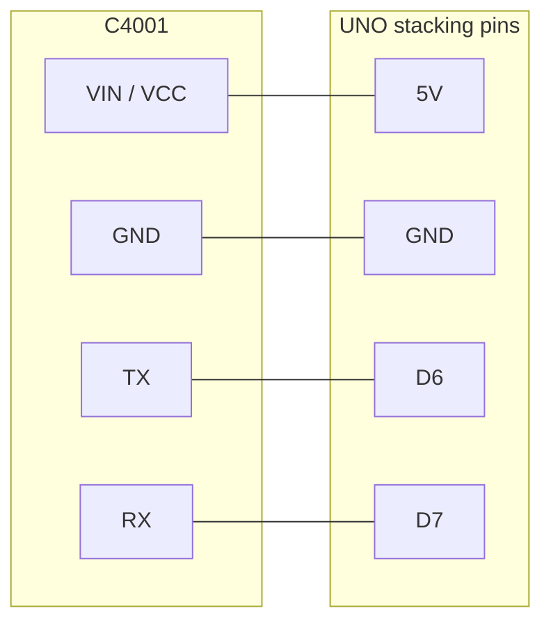

# human-presence-detector

Handheld presence display for an Arduino UNO R3, a 2.8" ILI9341 TFT shield, and a DFRobot C4001 24 GHz mmWave radar.

The screen shows **PRESENT** or **CLEAR** in large type, a big distance, speed, energy, and a top-down picture of the radar beam. The C4001 reports distance, speed, and energy. It does not report a left/right angle, so the picture draws the person as a band across the whole beam at that distance. Details are in [Direction](#direction).

Repository: [github.com/ironsbrodie-svg/human-presence-detector](https://github.com/ironsbrodie-svg/human-presence-detector)

## Parts

| Part | Notes |
| --- | --- |
| Arduino UNO R3 | The sketches are built for `arduino:avr:uno`. |
| 2.8" TFT shield, resistive touch, ILI9341 | Adafruit product 1651, or a clone with the same SPI wiring. Touch is not used. |
| DFRobot C4001, UART | 25 m module is SEN0609. The 12 m module is SEN0610. Same library, same wiring. |
| 4 jumper wires | Female ends for the shield's stacking pins. See colors below. |
| USB cable | Programming, and the first power source. |

The shield's microSD slot is unused. There is no SD library and no SD code. Digital pin 4 is still wired to the card's chip select, so the sketch drives D4 HIGH and that pin stays reserved.

## What the screen shows

Portrait, USB connector at the top of the UNO. If the picture is upside down, set `TFT_ROTATION` to `2` at the top of `presence_display.ino`.

| Region | Meaning |
| --- | --- |
| Green **PRESENT** / red **CLEAR** | Someone in the beam, or not. Letters are large on purpose so they read at arm's length. |
| Yellow distance | Smoothed range in meters. `--` when the radar has no range. |
| Cone | Top-down view. The sensor is the dot at the bottom and looks up the screen. A yellow arc is the range, stretched across the whole 100° beam. |
| **RANGE ONLY** | The module did not provide a left/right position. |
| SPEED / ENERGY | Relative speed and signal energy, in ranging mode. |

`SEARCHING` means the sketch is listening for a `$` frame. `CONFIG` means it is writing the mode and range into the module. That step often takes 10–20 seconds because the DFRobot library saves each setting. `NO SENSOR` with `TX to D6` / `RX to D7` means no frame arrived.

The display keeps updating with the USB cable unplugged from a computer. The sketch does not wait for the Serial Monitor.

## Wiring

Do this with the USB cable unplugged.

The C4001's own Uno example uses D4 and D5. Do not copy that while this shield is on the board. D4 is the microSD chip select.

### 1. Seat the shield

1. Unplug USB and any barrel supply.
2. Set the UNO on the table with the USB socket away from you.
3. Hold the shield above it, display up, and line up every header. The shield's 2x3 plug must meet the UNO's ICSP header (the 2x3 pins near the middle of the UNO, not a header at the edge).
4. Press straight down until the shield sits flush. Pins should be even on both long sides. A bent pin means pull the shield off and straighten it before trying again.

Adafruit 1651 is built with stacking headers. The UNO's pins pass through the shield and stick up as male pins. The sensor wires go on those exposed pins.

If a clone shield has no pins sticking up, the headers are buried. Do not force wires between the two boards. Fit stacking headers, or use an Adafruit WingShield (product 196) so D6, D7, 5V, and GND stay reachable.

### 2. Connect the C4001

Match the silkscreen on the module (`VIN` or `VCC`, `GND`, `TX`, `RX`, `OUT`). A factory Gravity lead uses its own colors. Trust the labels on the module, then use the colors below for loose jumpers so the harness is easy to check later.

| Order | Module pin | Wire | UNO pin (stacking header) |
| --- | --- | --- | --- |
| 1 | GND | Black | GND |
| 2 | TX | Yellow | D6 (UNO listens here) |
| 3 | RX | Blue | D7 (UNO talks here) |
| 4 | VIN / VCC | Red | 5V |
| — | OUT | Leave open | Not used |

Connect GND first and 5V last. TX and RX cross: the module's TX talks to the UNO's receive pin.

```
          C4001                         UNO + TFT shield
       (antenna faces                 (male pins on top
        away from you)                 of the shield)

         VIN / VCC  ---- red --------  5V
         GND        ---- black ------  GND
         TX         ---- yellow ------ D6     SoftwareSerial RX
         RX         ---- blue -------- D7     SoftwareSerial TX
         OUT        (no wire)

         Do not use D0 D1 D2 D4 D9 D10 D11 D12 D13  or  A4 A5
```



Power and logic: the module accepts 3.3 V or 5 V. Use the UNO **5V** pin. The UNO's 3.3 V pin cannot spare the radar's current (about 90 mA) on top of everything else. DFRobot's Uno examples connect the UART directly, with no level shifter, and this project does the same. Baud is 9600. The product specification lists 9600 as the default; the sketch opens 9600 to match `DFRobot_C4001`.

### 3. Check before you power it

- The shield is flush and the ICSP plug is seated.
- The red wire is on **5V** only. It is not on VIN, 3.3V, or IOREF.
- The black wire is on GND.
- Module **TX** goes to **D6**. Module **RX** goes to **D7**.
- Nothing is plugged into D0, D1, D4, or D9–D13.
- OUT has no wire. Bare strands are not touching the next pin.
- The microSD slot can stay empty. If a card is already in it, leave it; D4 is held high so the card stays off the SPI bus.

Then plug in USB.

## Pins the shield already uses

On an UNO, the 2x3 ICSP header and D11–D13 are the same SPI wires. A stock 1651 (SPI on the ICSP plug) and a shield jumpered over to D11–D13 both work on the UNO. They are not the same wires on a Mega. See [Migrating to Arduino Mega](#migrating-to-arduino-mega).

| UNO pin | Shield function | This project |
| --- | --- | --- |
| D13 / ICSP SCK | SPI clock | Display. Hands off. |
| D12 / ICSP MISO | SPI data in | Display. Hands off. |
| D11 / ICSP MOSI | SPI data out | Display. Hands off. |
| D10 | TFT chip select | Display. |
| D9 | TFT data/command | Display. |
| D4 | microSD chip select | Driven HIGH. Reserved. No SD library. |
| D2 | Touch interrupt (TSC2007), if the TSIRQ jumper is closed | Leave the jumper as it arrived. Do not use D2. |
| A4 / SDA, A5 / SCL | Touch controller I2C | Leave free. Touch is not read. |
| D8 | Touch chip select on older STMPE610 shields only | Driven HIGH so an old touch chip stays off SPI. |
| D3 | Backlight, only if the LITE/#3 jumper is soldered | Driven HIGH so the backlight stays on if that jumper is closed. |
| D6 | Free | SoftwareSerial RX. Sensor TX. |
| D7 | Free | SoftwareSerial TX. Sensor RX. |
| D0, D1 | USB serial | Left free so upload and the monitor still work. |

The UNO has one hardware UART, and it is the USB port. AltSoftSerial wants D8 and D9, and D9 is the TFT data/command pin, so it does not fit. SoftwareSerial on D6/D7 is the port that stays clear of the shield. Change that choice with one line when you move to a Mega (`RADAR_LINK`).

## Power

Start from the computer's USB port. After the sketch is on the board it runs with no Serial Monitor and no computer.

| Load | About | Where the number comes from |
| --- | --- | --- |
| UNO R3 | 50 mA | MCU, USB interface, and LEDs, typical |
| TFT shield, backlight full | 100 mA | Adafruit 1651 product page, display and touchscreen |
| C4001 | 90 mA | DFRobot SEN0609 specification, operating current |
| **Total** | **about 240 mA** | Use a supply that can deliver **500 mA** continuously |

The backlight is most of the shield's draw. This sketch leaves it fully on so the panel stays readable in sun.

### USB, including a power bank

Plug the bank or the PC into the UNO's USB-B socket. An official UNO fuses that input at 500 mA, and 240 mA sits inside that with margin. A bank that can supply 500 mA or more is enough. The board only draws what it needs.

### Barrel jack or VIN, for a wall supply

Use **7–12 V DC**, center positive, and prefer **7–9 V**. The onboard regulator is linear: it turns `(Vin − 5 V) × current` into heat. At 9 V and 0.24 A that is about 1 W. At 12 V it is about 1.7 W and the regulator runs hot. Above 12 V is a poor match for this load.

A 5 V adapter on the barrel jack or on VIN will not work. The regulator needs a couple of volts of headroom above 5 V. Five volts on VIN leaves the 5 V rail sagging and the board resets or runs brown-out.

You can leave a USB cable connected for the Serial Monitor while a barrel supply is plugged in. The UNO disconnects USB 5 V when VIN is present; the cable still carries data.

Do not tie a second 5 V supply into the 5 V header while the USB plug is also feeding the board from a computer. Those two 5 V sources fight.

## Libraries

Versions this repo was compiled against:

| Library | Version | Used for |
| --- | --- | --- |
| Adafruit ILI9341 | 1.7.0 | TFT |
| Adafruit GFX Library | 1.13.0 | Text and shapes |
| Adafruit BusIO | 1.17.4 | Installed with GFX |
| DFRobot_C4001 | 1.0.1 | SEN0609 / SEN0610 |

ILI9341 also pulls in Adafruit STMPE610, Adafruit TouchScreen, and Adafruit TSC2007. Those are touch drivers. The sketches do not include them. Do not add an SD library; the flash image is already at 98% of the UNO.

Arduino IDE: Library Manager, search each name, install those versions if you want a match.

arduino-cli:

```bash
arduino-cli core install arduino:avr
arduino-cli lib install "Adafruit ILI9341@1.7.0" "Adafruit GFX Library@1.13.0" "DFRobot_C4001@1.0.1"
```

Board package used here: `arduino:avr` 1.8.8. CLI: arduino-cli 1.5.1.

## Upload

1. Install the libraries above.
2. Tools → Board → **Arduino Uno**.
3. Open `presence_display/presence_display.ino`. The folder name and the file name match.
4. Select the UNO's port. Close the Serial Monitor if upload fails with "port busy".
5. Upload. The radar is on D6/D7, so it does not block the bootloader on D0/D1.
6. First boot shows `SEARCHING`, then `CONFIG` for up to about 20 seconds, then the live screen.

Optional log: Serial Monitor at **115200**. The sketch prints a short line when presence or the shown range changes, and only when the serial buffer has room, so a closed monitor does not stall the display.

### Other sketches

| Sketch | What it checks |
| --- | --- |
| `tft_test/tft_test.ino` | Shield only. Green **TFT OK**, color bars, a counter that repaints one box. D4 is held HIGH. |
| `c4001_serial_test/c4001_serial_test.ino` | Radar only, raw numbers, no smoothing. Monitor at 115200. Same D6/D7 wiring. D4 is held HIGH. |

Run `tft_test` when the panel stays white. Run the serial test when the main sketch sits on `NO SENSOR`. `no frame` in that test means power or TX/RX. `clear` after `ranging mode` means the link is up and the beam is empty.

## Settings at the top of the sketch

Everything you should turn lives at the top of `presence_display/presence_display.ino`.

### Indoor and outdoor

`RADAR_PRESET` selects the gate:

| Preset | Range | Threshold | Why |
| --- | --- | --- | --- |
| `PRESET_INDOOR` (default) | 0.6–6 m | 22 | A long gate sees through interior walls. 24 GHz also bounces off metal, mirrors, and large glass. Six meters covers a room and cuts a lot of that. |
| `PRESET_OUTDOOR` | 0.6–15 m | 12 | More distance. Wind-moved foliage and rain can look like a person; raise `RANGE_THRESHOLD` if the banner chatters. |

The threshold is the ranging-mode factor (`setThrFactor`). A larger number asks for a stronger, larger return. Edit the numbers inside the active `#if` block for a custom gate. Ranging mode on the 25 m module accepts up to about 2500 cm. Keep a 12 m SEN0610 at or below 1200 cm.

DFRobot notes that distance on this module is a guide, not a calibrated measurement, and that there is about a meter of transition past the configured maximum.

Outdoors in sun the backlight stays fully on and the banner is black-on-green or white-on-red. Shade the panel with a hand if it still washes out. Indoors, the same layout is just high contrast.

### Handheld use

The C4001 is designed to be mounted still. In your hand, your own walking makes stationary objects look like they are moving, so speed includes your pace and the range can wander. Readings are most trustworthy when you stop and hold the unit steady for a second.

Aim the antenna away from your body, roughly level or a little upward. The beam is about **100° wide and 40° tall**. Pointed level from chest height, the lower edge meets the ground a few meters ahead, and the sides take in nearby walls.

These knobs are the handheld filter, also at the top of the sketch:

| Define | Default | Effect |
| --- | --- | --- |
| `PRESENCE_HOLD_MS` | 1600 | PRESENT stays this long after the radar drops out, so the banner does not flicker. |
| `PRESENCE_ENTER_READS` | 2 | Consecutive hits required before PRESENT appears. Use 1 for a snappier response. |
| `DISTANCE_SMOOTH_DEN` | 4 | Each new sample is 1/4 of the number on screen. Higher is smoother and slower. |
| `DISTANCE_JUMP_M` | 1.5 | A single range jump larger than this is ignored until a second sample agrees. |
| `FRETTING_DETECTION` | 1 | Micro-motion on, so a still person can show up when you are still. Set to 0 to cut false hits while walking; a motionless person is then easier to miss. |

`RADAR_MODE` defaults to ranging, which is the mode that fills in distance, speed, and energy. `RADAR_MODE_PRESENCE` is the "someone is here, including someone standing still" mode. That mode has no range, so the big number becomes **IN BEAM** and the cone has no distance arc. In that mode the extra knobs are `TRIG_SENSITIVITY` and `KEEP_SENSITIVITY` (0–9, higher is more sensitive, datasheet default 7; handheld starts at 4) and `TRIG_DELAY_UNITS` / `KEEP_DELAY_UNITS` (0.2 s to accept a target, 4 s to hold it).

## Direction

The C4001 does not output a left/right angle.

The SEN0609 datasheet, section 3.2, defines the ranging sentence as `$DFDMD,par1,par2,par3,par4,par5,par6,par7*`:

| Field | Contents |
| --- | --- |
| par1 | Target count, 0 or 1 |
| par2 | Target id |
| par3 | Distance, meters |
| par4 | Speed, m/s |
| par5 | Energy |
| par6, par7 | Reserved placeholders |

`DFRobot_C4001` stores only count, range, speed, and energy (`sPrivateData_t`). The presence sentence `$DFHPD` is a yes/no flag plus reserved fields. The beam specification is 100° by 40°, which is the width of the cone, not a position inside it.

The screen therefore draws a **distance band across the whole cone**. A dot on that band would be a guess. The drawing code will place a dot when a reading sets `hasAngle` or `hasPosition` on `TargetFix`. The C4001 driver leaves both false.

Hardware that actually reports direction:

- A radar that outputs X/Y, such as the HLK-LD2450.
- Two C4001 modules as a coarse pair. That is not implemented here, and one UNO cannot listen to two of them reliably. See below.

## Future: adding direction tracking

The UI already takes a generic `TargetFix` (presence, distance, speed, energy, optional angle, optional x/y). `PresenceSensor` is the small driver interface (`begin`, `probe`, `configure`, `read`, plus what the sensor is able to report). A new file can implement that class for another radar. The cone and the text do not need to be rewritten. This repo does not include an LD2450 driver.

UNO limits if you add one later:

- SoftwareSerial can listen on one port at a time. Bit-banged receive is reliable around 9600. It is a poor fit at 115200 and it will not keep up with the LD2450's default **256000** baud.
- The UNO's only hardware UART is USB (D0/D1).
- A Mega 2560 (four hardware UARTs) or another board with extra hardware serial ports is the practical host. Put the C4001 on Serial1 and the LD2450 on Serial2. See the next section for the pins.

`TargetFix` is a single target. A multi-target radar can report the nearest one.

## Migrating to Arduino Mega

Stay on the UNO until you need a second, fast UART. When you move:

1. Tools → Board → **Arduino Mega or Mega 2560** (`arduino:avr:mega`).

2. Shield SPI. On the Mega, hardware SPI is D50 (MISO), D51 (MOSI), D52 (SCK), and D53 (SS). The 2x3 ICSP header in the **middle of the Mega** (the ATmega2560's header, the one an Uno shield plugs into) is that same SPI port. The second ICSP header up by the USB socket belongs to the USB chip. Do not use that one.
   - A stock 1651 talks SPI through the ICSP plug. Leave those jumpers. `TFT_CS` stays 10 and `TFT_DC` stays 9. The sketch already uses the board's hardware SPI, so the TFT constructor does not change.
   - If someone cut the ICSP jumpers and soldered the shield's SPI onto digital 11, 12, and 13, those pins are **not** SPI on a Mega. Move the jumpers back to ICSP.
   - D4 is still the microSD chip select and stays driven HIGH. D2 is still the touch interrupt. I2C moves to the SDA/SCL pins beside AREF (Mega D20/D21), which the shield already uses. This project still does not read touch.

3. Move the C4001 to a hardware UART. In `presence_display/presence_display.ino` change one line:

   ```cpp
   #define RADAR_LINK RADAR_LINK_SERIAL1
   ```

   Change the same line in `c4001_serial_test/c4001_serial_test.ino` if you use that test. Building a Mega sketch while `RADAR_LINK` is still `RADAR_LINK_SOFT` stops with `#error`, because `DFRobot_C4001` on a Mega only constructs a hardware serial port.

   | Signal | Mega pin |
   | --- | --- |
   | Sensor TX → board RX1 | 19 |
   | Sensor RX ← board TX1 | 18 |
   | VIN | 5V |
   | GND | GND |

   D6 and D7 are then free. Baud stays 9600 (`C4001_BAUD`).

4. A future LD2450 goes on **Serial2**: sensor TX to pin 17 (RX2), sensor RX to pin 16 (TX2), at 256000 baud, in a new `PresenceSensor` class. Leave the C4001 on Serial1. `RADAR_LINK_SERIAL2` exists so the C4001 itself can be moved if Serial1 is taken; it is not an LD2450 driver.

5. Power advice is the same. A Mega's own draw is a little higher than an UNO's; a 500 mA supply still covers this shield and radar.

## Troubleshooting

| What you see | What to check |
| --- | --- |
| White or blank TFT | Reseat the shield, especially the ICSP plug. Run `tft_test`. Try `TFT_ROTATION` 2. |
| Picture upside down | `TFT_ROTATION` 2. |
| `NO SENSOR` / serial test prints `no frame` | 5V and GND, then TX/RX. Module TX must be on D6. Baud 9600. |
| Stuck on `CONFIG` | The library waits until the module answers `sensorStop`. A TX wire with no RX wire can pass the search (the UNO hears `$`) and then wait forever. Power-cycle the sensor. Both signal wires have to be there. |
| Banner flickers while you walk | Expected. Hold still. Lengthen `PRESENCE_HOLD_MS`, raise `PRESENCE_ENTER_READS`, or set `FRETTING_DETECTION` to 0. |
| Ghosts indoors | You are seeing a wall or the next room. Use `PRESET_INDOOR` or shorten `RANGE_MAX_CM`. |
| Chatter outdoors in wind or rain | Raise `RANGE_THRESHOLD`. |
| Range looks wrong | The datasheet says this distance is not calibrated. Treat it as a guide. Very close targets (under about 1 m) are weak on this module. |
| Upload fails | Close the Serial Monitor. The radar should not be on D0/D1. |
| Backlight off | The LITE/#3 jumper was closed and D3 was low. This sketch drives D3 HIGH. Leave that jumper open unless you want GPIO control. |
| SPI garbage with a card installed | D4 is already held HIGH. Remove the card if the display still misbehaves. Do not add SD code; there is no flash left for it. |

## Compile check

Compiled with arduino-cli 1.5.1, `arduino:avr` 1.8.8, for `arduino:avr:uno`:

| Sketch | Flash | RAM globals |
| --- | --- | --- |
| `presence_display` | 31706 bytes (98% of 32256) | 1109 bytes (54%), 939 bytes left for stack and heap |
| `tft_test` | 12470 bytes (38%) | 450 bytes (21%) |
| `c4001_serial_test` | 14122 bytes (43%) | 586 bytes (28%) |

A Mega build with `RADAR_LINK` set to `RADAR_LINK_SERIAL1` also compiles (`presence_display` about 31540 bytes, 12% of the Mega). The copy in this repo stays on `RADAR_LINK_SOFT` for the UNO.

The main image is tight because the official C4001 library and Adafruit GFX both land in the 32 KB. Leave out SD, touch, and custom fonts.
