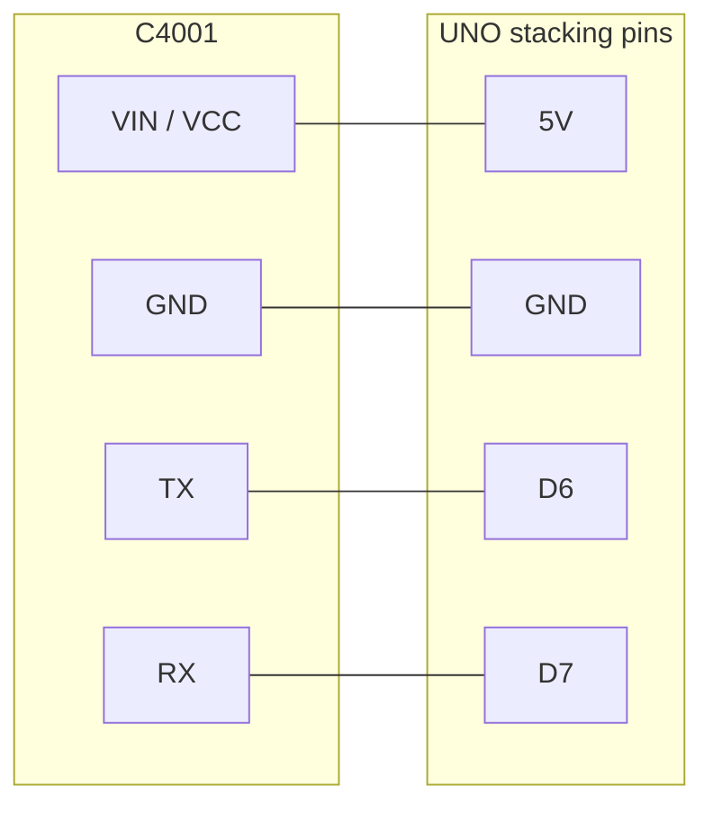

# -uno-tft-mmwave-presence

Handheld presence display for an Arduino UNO R3, a 2.8" ILI9341 TFT shield, and a DFRobot C4001 24 GHz mmWave radar.

The screen shows **PRESENT** or **CLEAR** in large type, a distance in meters, speed, and energy, plus a top-down picture of the beam. The C4001 reports distance, speed, and energy. It does not report a left/right angle, so the picture is a band across the whole beam. See [Direction](#direction).

Repository: [github.com/ironsbrodie-svg/-uno-tft-mmwave-presence](https://github.com/ironsbrodie-svg/-uno-tft-mmwave-presence)

## Parts

| Part | Notes |
| --- | --- |
| Arduino UNO R3 | Sketches build for `arduino:avr:uno`. |
| 2.8" TFT shield, resistive, ILI9341 | Adafruit product 1651, or a clone with the same SPI wiring. Touch is not used. |
| DFRobot C4001, UART | 25 m module is SEN0609 (default in the sketch). 12 m module is SEN0610. |
| 4 jumper wires | Female ends for the shield's stacking pins. |
| USB cable | Programming, and the first power source. |

The microSD slot is unused. There is no SD library. Digital pin 4 is still the card's chip select, so every sketch drives D4 HIGH and that pin stays free of the radar.

## What the screen shows

Portrait, USB socket at the top of the UNO. If the picture is upside down, set `TFT_ROTATION` to `2` at the top of `presence_display/presence_display.ino`.

| Region | Meaning |
| --- | --- |
| Green **PRESENT** / red **CLEAR** | Someone in the beam, or not. |
| Yellow distance | Smoothed range, for example `6.0m`. `--` when there is no range. Presence mode shows `HERE`. |
| Cone | Sensor at the bottom, looking up the screen. A yellow arc is the range across the full horizontal beam. The white number at the lower right is the configured maximum. |
| SPEED / ENERGY | Relative speed (m/s) and signal energy, in ranging mode. Hidden while the presence hold is coasting. |

`SEARCHING` means the sketch is waiting for a `$...*` frame. `CHECKING` means it has stopped the module and is reading the settings back. That is every boot, on purpose. `NO SENSOR` means no frames (check power and the module TX wire). `NO RX` means frames arrived but the module did not answer a command (check the wire from the UNO's TX pin to the module RX). `CFG FAIL` names the command that did not return `Done`. Nothing was saved in that case.

The display runs with no Serial Monitor. The sketch does not wait for USB.

## Wiring

Do this with USB unplugged.

DFRobot's own Uno example uses D4 and D5. Do not use those pins with this shield. D4 is the microSD chip select.

### 1. UART / I2C switch

The 12 m SEN0610 wiki tells you to set the DIP switch on the back of the sensor to **UART** before the serial demo (and to IIC for the I2C demo).

The 25 m SEN0609 pinout is `VIN`, `GND`, `RX`, `TX`, `OUT`. A DFRobot forum report on that 25 m board says it has no DIP switch. If your board has the switch, set it to UART before power-up. If it has none, use the pins labeled RX and TX.

### 2. Seat the shield

1. Unplug USB and any barrel supply.
2. Set the UNO on the table with the USB socket away from you.
3. Line the shield up with every header. Its 2x3 plug must meet the UNO's ICSP header (the 2x3 pins near the middle, not a header at the edge).
4. Press straight down until the shield sits flush.

Adafruit 1651 uses stacking headers, so the UNO pins stick up as male pins. Put the sensor wires on those.

If a clone has no pins sticking up, do not force wires between the boards. Fit stacking headers, or use an Adafruit WingShield (product 196).

### 3. Connect the C4001

Match the silkscreen (`VIN` or `VCC`, `GND`, `TX`, `RX`, `OUT`). A factory Gravity lead has its own colors. Trust the labels, then use the colors below on loose jumpers.

| Order | Module pin | Wire | UNO pin |
| --- | --- | --- | --- |
| 1 | GND | Black | GND |
| 2 | TX | Yellow | D6 (UNO listens) |
| 3 | RX | Blue | D7 (UNO talks) |
| 4 | VIN / VCC | Red | 5V |
| — | OUT | Leave open | Not used |

TX and RX cross: the module's TX talks to the UNO's receive pin.

```
          C4001                         UNO + TFT shield

         VIN / VCC  ---- red --------  5V
         GND        ---- black ------  GND
         TX         ---- yellow ------ D6
         RX         ---- blue -------- D7
         OUT        (no wire)
```

Power: the module is specified for a 3.3 V or 5 V supply. Use the UNO **5V** pin. The UNO 3.3 V pin is too small for the radar (about 90 mA) as well as the board.

Logic level, stated carefully:

- Confirmed: DFRobot's Uno examples connect the UART pins straight to 5 V GPIO, and the supply pin accepts 3.3 V or 5 V. Baud in those examples and in the product spec is 9600.
- Not confirmed: whether the module RX pin is 5 V tolerant. No VIH / IO-voltage table was found for SEN0609 or SEN0610.
- Cautious option, if you want a 3.3 V high into the module: 1 kΩ from UNO D7 to the module RX pin, and 2 kΩ from that RX pin to GND. That is about 3.3 V. Do not put that divider on the module TX wire. A 3.3 V output from the module into D6 is already a valid high for the UNO.



### 4. Check before power

- Shield flush, ICSP plug seated.
- Red wire on **5V** only. Not VIN, not 3.3V, not IOREF.
- Black wire on GND.
- Module TX to D6. Module RX to D7.
- Nothing on D0, D1, D4, or D9–D13.
- OUT has no wire.
- DIP switch on UART if the board has one.
- MicroSD slot may stay empty. A card left in it stays off the bus because D4 is held high.

Then plug in USB.

## Pins the shield already uses

On an UNO, the ICSP header and D11–D13 are the same SPI wires. A stock 1651 and a shield jumpered over to D11–D13 both work on the UNO. They are different wires on a Mega.

| UNO pin | Shield function | This project |
| --- | --- | --- |
| D13 / ICSP SCK | SPI clock | Display |
| D12 / ICSP MISO | SPI data in | Display |
| D11 / ICSP MOSI | SPI data out | Display |
| D10 | TFT chip select | Display |
| D9 | TFT data/command | Display |
| D4 | microSD chip select | Driven HIGH. Reserved. |
| D2 | Touch interrupt, if the TSIRQ jumper is closed | Leave it. |
| A4 / SDA, A5 / SCL | Touch controller I2C | Leave them. Touch is not read. |
| D8 | Touch chip select on older STMPE610 shields | Driven HIGH. |
| D3 | Backlight, only if the LITE/#3 jumper is closed | Driven HIGH so the backlight stays on. |
| D6 | Free | SoftwareSerial RX. Sensor TX. |
| D7 | Free | SoftwareSerial TX. Sensor RX. |
| D0, D1 | USB serial | Left free for upload. |

The UNO's only hardware UART is USB. AltSoftSerial wants D8 and D9, and D9 is the TFT data/command pin. SoftwareSerial on D6/D7 is the free pair. `RADAR_LINK` at the top of the sketch is the one-line change for a Mega.

## Power

Start from the computer's USB port. After upload the sketch runs with no Serial Monitor and no computer.

| Load | About | Source |
| --- | --- | --- |
| UNO R3 | 50 mA | MCU, USB chip, LEDs, typical |
| TFT shield, backlight full | 100 mA | Adafruit 1651 product page |
| C4001 | 90 mA | DFRobot SEN0609 operating current |
| **Total** | **about 240 mA** | Use a supply that can deliver **500 mA** |

### USB, including a power bank

Plug the bank or the PC into the USB-B socket. An official UNO fuses that input at 500 mA. A bank rated 500 mA or more is enough.

### Barrel jack or VIN

Use **7–12 V DC**, center positive, and prefer **7–9 V**. The onboard regulator is linear: `(Vin − 5 V) × current` becomes heat. At 9 V and 0.24 A that is about 1 W. At 12 V it is about 1.7 W.

A 5 V adapter on the barrel jack or on VIN will not regulate to a solid 5 V rail. The regulator needs headroom above 5 V.

You can leave USB connected for the Serial Monitor while a barrel supply is plugged in. The UNO disconnects USB 5 V when VIN is present. The cable still carries data.

Do not feed a second 5 V supply into the 5 V header while the USB plug is also powering the board from a computer.

## Libraries

The sketches talk to the C4001 directly. They do not link `DFRobot_C4001`. That library's `sensorStop()` waits forever for an echo, and every setter calls it. The command set in the sketch is the one documented for SEN0609 (sensorStop, get/set, saveConfig, sensorStart) with a timeout on each reply.

Display libraries this tree was compiled against:

| Library | Version |
| --- | --- |
| Adafruit ILI9341 | 1.7.0 |
| Adafruit GFX Library | 1.13.0 |
| Adafruit BusIO | 1.17.4 |

ILI9341 also installs Adafruit STMPE610, TouchScreen, and TSC2007. The sketches do not include them. Do not add an SD library.

```bash
arduino-cli core install arduino:avr
arduino-cli lib install "Adafruit ILI9341@1.7.0" "Adafruit GFX Library@1.13.0"
```

Board package used here: `arduino:avr` 1.8.8.

## Upload

1. Install the display libraries.
2. Tools → Board → **Arduino Uno**.
3. Open `presence_display/presence_display.ino`.
4. Select the port. Close the Serial Monitor if the port is busy.
5. Upload. The radar is on D6/D7, so it does not block the bootloader.
6. The TFT shows `SEARCHING` as soon as the panel initialises, then `CHECKING` while settings are read back.

Optional log: Serial Monitor at **115200**. Lines are printed only when the USB buffer has room.

### Other sketches

| Sketch | What it checks |
| --- | --- |
| `tft_test/tft_test.ino` | Reads ILI9341 ID register 0xD3. **PASS** when the bytes are 93 41. Counter repaints one box. D4 held HIGH. |
| `c4001_serial_test/c4001_serial_test.ino` | Radar only. Prints `PASS tx+rx` or `FAIL tx` / `FAIL rx`. Heartbeat `hb frames=N` once a second. Does not save settings. |
| `bringup_test/bringup_test.ino` | TFT ID and the radar TX/RX round trip on one screen. |

### Sensor unplugged mid-run

This was not run on hardware here. The procedure:

1. Upload `presence_display` and wait until the banner is PRESENT or CLEAR.
2. Unplug the yellow wire (module TX to D6), or unplug the module.
3. Within about 2 seconds the banner should leave PRESENT/CLEAR and show NO SENSOR. It should not stay on CLEAR.
4. Plug the wire back. The sketch probes again, checks settings, and returns to the live screen. It should not sit on CHECKING forever, and it should not show NO RX unless the D7 wire is the one that's open.

## Settings

All of these are at the top of `presence_display/presence_display.ino`.

### Model and preset

`C4001_MODEL` is `C4001_MODEL_25M` (2500 cm cap) or `C4001_MODEL_12M` (1200 cm cap). The active preset is clipped to that cap.

| Preset | Range | Threshold |
| --- | --- | --- |
| `PRESET_INDOOR` (default) | 0.6–6 m | 22 |
| `PRESET_OUTDOOR` | 0.6–15 m | 12 |

Threshold is the ranging-mode factor. Larger means a stronger return is required. Indoor walls reflect 24 GHz, so the short gate is the default. Outdoors, wind-moved foliage and rain can chatter the banner; raise the threshold if they do. In sun the backlight stays fully on.

DFRobot says the distance figure is a guide, not a calibrated measurement, and that there is about a meter of transition past the configured maximum.

Beam angle, from the product pages:

| Module | Horizontal | Vertical |
| --- | --- | --- |
| SEN0609, 25 m | 100° | 40° |
| SEN0610, 12 m | 100° | 80° |

The drawing uses the shared 100° width. The vertical angle is not on the screen.

### Handheld

This radar is meant to be mounted still. Walking makes stationary objects look like motion, so the speed includes your pace. Readings are most trustworthy when you stop and hold the unit steady.

Aim the antenna away from your body, level or a little up. Pointed level from chest height, the lower edge of the beam meets the ground a few meters ahead.

| Define | Default | Effect |
| --- | --- | --- |
| `PRESENCE_HOLD_MS` | 1600 | PRESENT stays this long after a real clear frame. |
| `PRESENCE_ENTER_READS` | 2 | Hits add 2 to a score, misses subtract 1. PRESENT latches at 4, so one miss does not wipe two hits. |
| `DISTANCE_SMOOTH_DEN` | 4 | Each new sample is 1/4 of the number on screen. |
| `DISTANCE_JUMP_CM` | 150 | A single step larger than this waits for a second sample. |
| `FRETTING_DETECTION` | 1 | Micro-motion on, so a still person can register when you are still. |
| `LINK_TIMEOUT_MS` | 2000 | No complete frame for this long is a dead link, not an empty room. |

`RADAR_MODE_RANGING` (default) has distance, speed, and energy. `RADAR_MODE_PRESENCE` reports someone in the beam, including someone standing still, and has no range. In that mode the extra knobs are `TRIG_SENSITIVITY`, `KEEP_SENSITIVITY` (0–9, higher is more sensitive), and the latency units above.

Every boot the sketch stops the module, reads the settings back, and writes them only when a value differs. The datasheet says a change does not take effect and does not survive a restart unless `saveConfig` is sent. One `saveConfig` is sent after a real change, and only after each `set` command has returned `Done`. A failed command does not save. Unsaved commands are not treated as "good enough"; the datasheet says they do not take effect.

## Boot time

Not measured on a bench. Estimated from the code.

The previous sketch called `DFRobot_C4001`, which waits a fixed 1 s in `begin()` on the Uno and a fixed 1 s inside every `sensorStop()`. A full configure called that stop three times, so a normal boot was on the order of 7–11 s, and a missing RX wire never returned.

This sketch:

- Draws `SEARCHING` as soon as `tft.begin()` returns. There is no added splash delay.
- Sends no configuration until a real frame has arrived, so a module that just powered up is not written to before it is already transmitting. The datasheet's "wait 1 s after power before parameter commands" is covered by that, rather than by a blind sleep after the frame.
- The "you can check for a response after 3 s" line is why a missing sensor is not declared until the 2 s listen plus a 1 s `sensorStart` attempt (no flash write) have both failed.
- Still stops the module and reads the settings back on every boot. That check was not removed to make boot faster.
- Waits for `Done` or `Error` instead of the library's fixed 1 s pause, and does not send the next command before that reply. Timeouts are caps (0.8 s for a get/set, 2 s for stop and `saveConfig`), not extra delays after `Done`.
- Does not call `resetSystem` or `resetCfg`.

When the settings already match, expect the check to finish a few seconds after the first frame, mostly in the module's own replies. When something differs, add those `set` commands and one `saveConfig`. The presence hold and the sensitivity numbers were not shortened.

## Direction

The C4001 does not output a left/right angle.

The SEN0609 datasheet, section 3.2, defines `$DFDMD` as target count, target id, distance, speed, energy, and two reserved fields. `$DFHPD` is a yes/no flag plus reserved fields. `DFRobot_C4001` stores only count, range, speed, and energy.

The on-screen arc is that distance across the whole 100° beam.

`presence_display/future/directional_view.h` draws a bearing dot from `hasAngle` or x/y. The UNO sketch does not include it (`CONE_DIRECTIONAL` is 0), so it is not in the UNO binary. A Mega build sets `CONE_DIRECTIONAL` to 1. An HLK-LD2450 driver is not included. Its default baud is 256000. SoftwareSerial on the UNO cannot keep up with that, and it can listen to only one port. On a Mega, put the C4001 on Serial1 and a future LD2450 on Serial2 (module TX to pin 17, module RX to pin 16).

## Buffers

| Buffer | Size | Why it is enough |
| --- | --- | --- |
| SoftwareSerial RX | 64 bytes, fixed in the library | At 9600 baud that is about 67 ms of data. The loop drains every 40 ms, about 38 bytes, so the ISR buffer is not left to overflow. A sketch `#define` does not resize it. |
| Frame assembly | 80 bytes | A ranging frame is under 50 bytes. 80 bytes holds one frame plus the start of the next, so the newest complete `$...*` can be kept. Longer junk is dropped, not parsed. |
| One parsed line | 56 bytes, stack, only while parsing | Shorter than the assembly buffer on purpose. An over-long frame is discarded. |
| Command reply | 80 bytes, stack, only during CHECKING | A flushed get/set reply (`Response ... Done`) fits. The front of the buffer is kept so `Response` is not slid away before `Done`. |

`TargetFix` on the UNO is integers (centimeters, cm/s, energy). The angle and x/y fields are compiled only with `CONE_DIRECTIONAL`.

## Migrating to Arduino Mega

1. Tools → Board → **Arduino Mega or Mega 2560**.
2. Shield SPI on the Mega is D50 (MISO), D51 (MOSI), D52 (SCK). The ICSP header in the **middle** of the Mega is that SPI port. The ICSP header by the USB socket is the USB chip. A stock 1651 uses the middle ICSP plug. `TFT_CS` stays 10 and `TFT_DC` stays 9. A shield whose SPI jumpers were moved to D11–D13 will not see SPI on a Mega until those jumpers go back to ICSP. D4 is still the SD chip select and stays HIGH.
3. In `presence_display.ino` change one line to `#define RADAR_LINK RADAR_LINK_SERIAL1`. Do the same in `c4001_serial_test.ino` if you use it. Sensor TX goes to pin 19, sensor RX to pin 18.
4. For the directional overlay, set `#define CONE_DIRECTIONAL 1` as well. Leave Serial2 free for a later LD2450.
5. Building a Mega sketch while `RADAR_LINK` is still `RADAR_LINK_SOFT` stops with `#error` and the board name.

## Troubleshooting

| What you see | What to check |
| --- | --- |
| White TFT, or `tft_test` prints FAIL | Reseat the shield, including ICSP. PASS needs ID bytes 93 41. |
| Picture upside down | `TFT_ROTATION` 2. |
| `NO SENSOR` / serial test `FAIL tx` | 5V, GND, module TX to D6, DIP switch on UART if there is one. |
| `NO RX` / serial test `FAIL rx` | UNO D7 to module RX. Frames prove the other direction works. |
| `CFG FAIL` and a command name | That command did not return `Done`. Settings were not saved. Power-cycle the module and check the wiring. |
| `FAIL link` or NO SENSOR after it was working | The TX wire or the module dropped. Plug it back; the sketch probes again. |
| Banner flickers while you walk | Expected. Hold still. Lengthen `PRESENCE_HOLD_MS` or set `FRETTING_DETECTION` to 0. |
| Ghosts indoors | Shorten `RANGE_MAX_CM` or stay on `PRESET_INDOOR`. |
| Chatter outdoors in wind or rain | Raise `RANGE_THRESHOLD`. |
| Range looks wrong | DFRobot says it is not calibrated. Targets under about 1 m are weak. |
| Upload fails | Close the Serial Monitor. The radar should not be on D0/D1. |
| Backlight off | LITE/#3 was closed. This sketch drives D3 HIGH. |

## Compile check

arduino-cli, `arduino:avr` 1.8.8.

| Sketch | Board | Flash | RAM globals |
| --- | --- | --- | --- |
| `presence_display` before this pass | Uno | 31706 bytes (98%) | 1109 bytes (54%) |
| `presence_display` | Uno | 25124 bytes (77%) | 1066 bytes (52%) |
| `tft_test` | Uno | 12942 bytes (40%) | 450 bytes (21%) |
| `c4001_serial_test` | Uno | 4644 bytes (14%) | 408 bytes (19%) |
| `bringup_test` | Uno | 14130 bytes (43%) | 559 bytes (27%) |
| `presence_display`, `RADAR_LINK_SERIAL1` | Mega | 25018 bytes (9%) | 1106 bytes |
| same, plus `CONE_DIRECTIONAL 1` | Mega | 26302 bytes (10%) | 1119 bytes |

The UNO image does not contain `dirSin256` / the directional overlay. The Mega image with `CONE_DIRECTIONAL 1` does. Adafruit BusIO still links the Wire library; that is the display stack, not the radar driver. Flash is at 77%, so that was left as-is.
